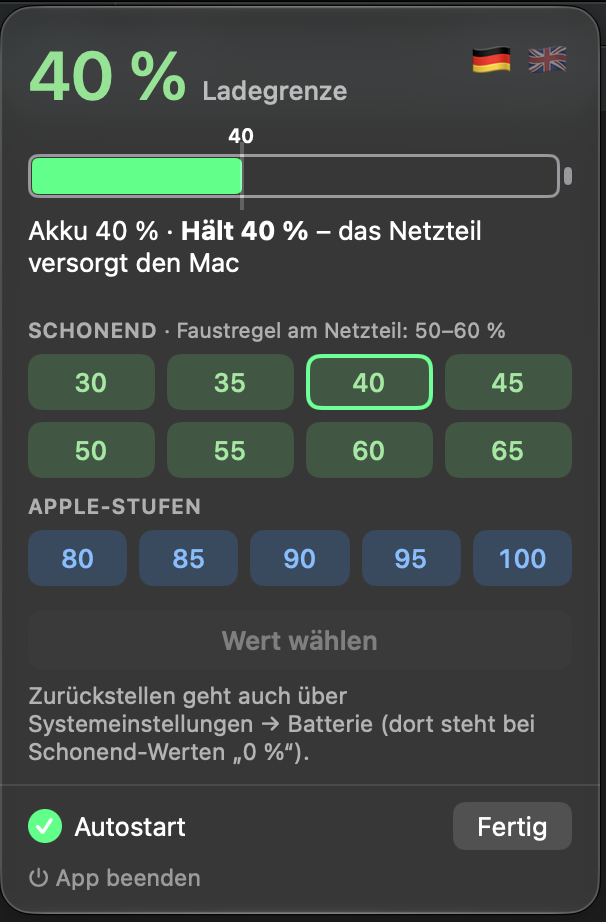

# ChargeLimit

**ChargeLimit setzt die Ladegrenze Ihres MacBook-Akkus auch unter Apples 80 % — bis hinunter auf 30 %.**

macOS hat eine eingebaute Ladegrenze (Systemeinstellungen → Batterie), die aber nur bis 80 % hinunter reicht.
ChargeLimit stellt Apples eigene Grenze auf **30–65 %** — oder auf Apples übliche Stufen 80–100 %.

[English version](README.md)

<p align="center"></p>

## Warum ChargeLimit?

Wer sein MacBook ständig an einer Dockingstation oder einem Thunderbolt-Hub mit Stromversorgung betreibt, hält den
Akku fast immer voll — und genau das lässt ihn schneller altern. ChargeLimit hält ihn stattdessen auf dem Wert, den
Sie wählen, auch unter Apples 80 %, zum Beispiel bei 40 % — damit er deutlich langsamer altert.
Für eine Reise stellen Sie mit einem Klick wieder auf 100 %.

## Was die App macht

- **Zwei Knopfreihen:** *Schonend* 30, 35 … 65 % (grün) und *Apple-Stufen* 80, 85 … 100 % (blau).
- **Nutzt Apples eigene Ladegrenze** — dieselbe wie in Systemeinstellungen → Batterie.
  ChargeLimit setzt nur den Wert, den Rest erledigt macOS.
- **Nichts muss dauerhaft laufen.** Die Grenze bleibt auch nach dem Beenden der App und nach einem Neustart
  des Macs bestehen — die App braucht man nur zum Umstellen.
- **Funktioniert auch bei eingeschaltetem „Optimiertes Laden der Batterie“** — in zwei Nächten getestet, die Grenze hat gehalten.
- **Sperrt das Laden nie ganz:** Der kleinste mögliche Wert ist 30 %.
- **Deutsch und Englisch**, im Fenster umschaltbar.
- **Autostart auf Wunsch**, damit das Symbol in der Menüleiste immer da ist.

## Voraussetzungen

- Ein MacBook mit **Apple-Chip** (M-Serie)
- **macOS 27** oder neuer
- Das **Kennwort eines Administrators** dieses Macs (bei 100 % = keine Grenze nicht nötig)
- Beim Umstellen muss das **Netzteil angesteckt** sein

Getestet auf einem MacBook Pro (M5 Max) mit macOS 27.2.1. Andere Modelle sollten genauso funktionieren,
sind aber noch nicht getestet — Rückmeldungen von anderen Macs sind sehr willkommen (siehe *Rückmeldungen* unten).

## Installieren

1. **ChargeLimit.dmg** von der [Release-Seite](https://github.com/chargelimit/chargelimit/releases/latest) herunterladen.
2. Öffnen und **ChargeLimit** in den Ordner **Programme** ziehen.
3. **Erster Start:** ChargeLimit ist kostenlos und kommt nicht aus dem App Store, deshalb fragt macOS einmal nach.
   Erscheint *„ChargeLimit kann nicht geöffnet werden“*:
   Systemeinstellungen → **Datenschutz & Sicherheit** → nach unten scrollen → bei ChargeLimit auf **Trotzdem öffnen**.
4. Meldet macOS, die App sei *„beschädigt“*: Programm **Terminal** öffnen (Cmd + Leertaste → „Terminal“ → Enter)
   und diese Zeile eingeben:
   ```
   xattr -cr /Applications/ChargeLimit.app
   ```

**Zum Kennwort-Fenster:** Beim Setzen eines Werts zeigt macOS sein eigenes Kennwort-Fenster. Weil die App nicht von
Apple beglaubigt ist, kann dort stehen, Apple habe nicht bestätigen können, dass das Skript frei von Schadsoftware ist.
Das ist der übliche Text für jedes Werkzeug außerhalb des App Stores, das Administrator-Rechte braucht.
Der vollständige Quellcode liegt in diesem Verzeichnis — alles, was die App mit dieser Berechtigung tut, steht in
[`Setzen.swift`](Sources/ChargeLimitKit/Setzen.swift): Sie trägt den Grenzwert in Apples Ladegrenzen-Einstellung ein, sonst nichts.

## Benutzen

Auf das Akku-Symbol in der Menüleiste klicken → Wert antippen → **„Grenze auf … % setzen“** → Kennwort eingeben.

Wieder normal laden: **100** antippen → **„Grenze auf 100 % setzen“** (ohne Kennwort).
Umstellen geht auch in Systemeinstellungen → Batterie (bei Werten unter 80 % steht dort „0 %“).

Bis macOS eine neue Grenze im Fenster bestätigt, kann es einige Minuten dauern.

## Entfernen

1. In ChargeLimit die Grenze auf **100 %** setzen (sonst bleibt die zuletzt gesetzte Grenze aktiv).
2. Im Fenster „Autostart“ ausschalten.
3. ChargeLimit beenden und aus dem Programme-Ordner in den Papierkorb ziehen.

## Gut zu wissen

- ChargeLimit schreibt in eine **nicht dokumentierte** Apple-Einstellung. Ein künftiges macOS-Update könnte das
  ändern — funktioniert die App nach einem Update nicht mehr, bitte eine Meldung anlegen.
- Auf einem Mac ohne Akku (iMac, Mac mini, Mac Studio) zeigt die App einen kurzen Hinweis und beendet sich.
- Dank an [batt](https://github.com/charlie0129/batt): Dessen Untersuchungen zu macOS 27 haben gezeigt, über welche
  Apple-Schnittstellen sich die Ladegrenze steuern lässt. ChargeLimit ist eine eigene, viel kleinere Umsetzung.

## Selbst bauen

Braucht die Xcode-Befehlszeilenwerkzeuge (`xcode-select --install`).

```
swift test
bash bauen.sh
```

App und DMG liegen danach in `build/`.

## Rückmeldungen

Einen Fehler gefunden oder auf einem anderen Mac getestet? Bitte eine [Meldung (Issue)](https://github.com/chargelimit/chargelimit/issues) anlegen und
Mac-Modell und macOS-Version angeben. Ein kostenloses Freizeitprojekt — ohne Zusage, wie schnell eine Antwort kommt.

## Lizenz

[MIT](LICENSE) — frei nutzbar, veränderbar und weitergebbar. Ohne Gewähr.
