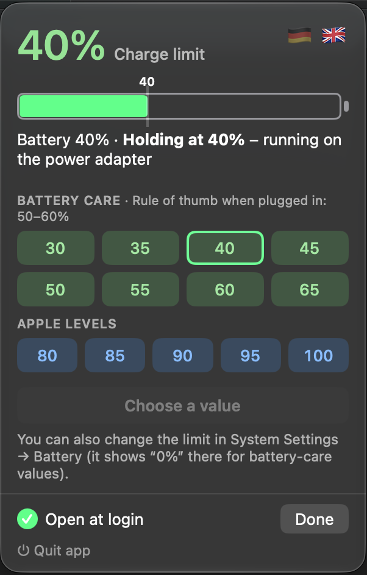

# ChargeLimit

**ChargeLimit sets your MacBook's battery charge limit below Apple's 80 % — all the way down to 30 %.**

macOS has a built-in charge limit (System Settings → Battery), but it only goes down to 80 %.
ChargeLimit lets you set Apple's own limit to **30–65 %** — or to Apple's regular steps of 80–100 %.

[Deutsche Fassung](README.de.md)

<p align="center"></p>

## Why ChargeLimit?

If your MacBook lives on a powered dock or Thunderbolt hub, its battery sits almost full all day — and that is
exactly what wears it out faster. ChargeLimit keeps it at the level you choose, even below Apple's 80 % (say 40 %),
so it ages much more slowly. When you need the full range for a trip, set it back to 100 % with one click.

## What it does

- **Two rows of buttons:** *Battery care* 30, 35 … 65 % (green) and *Apple levels* 80, 85 … 100 % (blue).
- **Uses Apple's own charge limit** — the same one you find in System Settings → Battery.
  ChargeLimit only sets the value; macOS does the rest.
- **Nothing needs to keep running.** The limit stays in place after you quit the app and after you restart
  your Mac — the app is only needed to change the value.
- **Works with "Optimized Battery Charging" turned on** — tested over two nights, the limit held.
- **Never blocks charging completely:** the lowest possible value is 30 %.
- **English and German**, switchable in the window.
- **Optional "Open at login"**, so the menu bar icon is always there.

## Requirements

- A MacBook with **Apple silicon** (M-series chip)
- **macOS 27** or later
- An **administrator password** for this Mac (not needed for 100 % = no limit)
- The **power adapter must be connected** while you change the limit

Tested on a MacBook Pro (M5 Max) with macOS 27.2.1. Other models should work the same way, but
have not been tested yet — reports from other Macs are very welcome (see *Feedback* below).

## Install

1. Download **ChargeLimit.dmg** from the [Releases page](https://github.com/chargelimit/chargelimit/releases/latest).
2. Open it and drag **ChargeLimit** into the **Applications** folder.
3. **First start:** ChargeLimit is free and not distributed through the App Store, so macOS asks once
   whether you trust it. If you see *"ChargeLimit cannot be opened"*:
   System Settings → **Privacy & Security** → scroll down → **Open Anyway** next to ChargeLimit.
4. If macOS says the app *"is damaged"*, open **Terminal** (Cmd + Space → type "Terminal" → Enter)
   and run:
   ```
   xattr -cr /Applications/ChargeLimit.app
   ```

**About the password window:** when you set a value, macOS shows its own password prompt. Because the
app is not notarized by Apple, the prompt may say that Apple could not verify the script is free of
malware. That is the standard text for any non-App-Store tool asking for administrator rights.
The complete source code is in this repository — everything the app does with that permission is in
[`Setzen.swift`](Sources/ChargeLimitKit/Setzen.swift): it writes the limit value into Apple's charge-limit setting, nothing else.

## Use

Click the battery icon in the menu bar → tap a value → **"Set limit to … %"** → enter your password.

To charge normally again: tap **100** → **"Set limit to 100 %"** (no password needed).
You can also change the limit in System Settings → Battery (for values below 80 % it shows "0 %" there).

A new limit can take a few minutes until macOS confirms it in the window.

## Uninstall

1. In ChargeLimit, set the limit to **100 %** (otherwise your last limit stays active).
2. Turn off "Open at login" in the window.
3. Quit ChargeLimit and drag it from Applications to the Trash.

## Good to know

- ChargeLimit writes to an **undocumented** Apple setting. A future macOS update could change that —
  if the app stops working after an update, please open an issue.
- On a Mac without a battery (iMac, Mac mini, Mac Studio) the app shows a short notice and quits.
- Thanks to [batt](https://github.com/charlie0129/batt), whose research on macOS 27 showed which
  Apple interfaces control the charge limit. ChargeLimit is a separate, much smaller implementation.

## Build from source

Requires the Xcode Command Line Tools (`xcode-select --install`).

```
swift test
bash bauen.sh
```

The app and the DMG end up in `build/`.

## Feedback

Found a bug, or tested it on another Mac? Please open an [issue](https://github.com/chargelimit/chargelimit/issues) and mention your Mac
model and macOS version. This is a free spare-time project — no promises on response times.

## License

[MIT](LICENSE) — free to use, change and share. Provided as is, without warranty.
